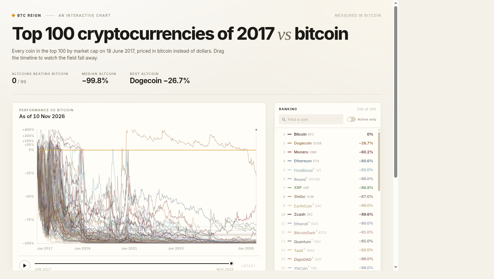

# BTC Reign



An interactive version of the print chart **“Top 100 cryptocurrencies of 2017 vs bitcoin.”** One hundred coins, one hundred paths, measured against bitcoin from 18 June 2017 to today.

- Hover the plot for a crosshair and a coin-by-coin readout.
- Click a line or a list row to pin a coin and see its peak, trough, price in BTC, and 2017 market cap.
- Drag the timeline (or press play) to watch the ranking re-sort in real time.
- Search the field, hide delisted coins, and follow the handful of alts that ever beat bitcoin.

The y-axis is deliberately unusual: logarithmic above 0% so the early blow-off tops stay readable, linear below 0% so the long tail near −100% stays distinguishable. That is the same treatment as the original chart.

## Run

```bash
npm install
npm run dev
```

Production build:

```bash
npm run build
npm run preview
```

## Refresh the data

The chart is static JSON (`src/data/coins.json`) so the page loads instantly and works offline. To rebuild it from current sources:

```bash
node scripts/build-data.mjs
```

The script reads `scripts/top100.json` (the 18 June 2017 CoinMarketCap snapshot: rank, ids, prices, market caps, and the final values printed in the chart), then:

1. Fetches BTC-denominated daily closes from CoinMarketCap's public data API.
2. Fills gaps for coins CoinMarketCap has purged using CoinCodex's chart API, converting USD closes to BTC.
3. Reconstructs the six coins with no surviving series (BitConnect, LEOcoin, HyperSpace, YbCoin, EDC Blockchain, and Burst) from a market-median shape anchored to the value printed in the original chart.
4. Freezes coins marked **†** at their last tracked value, matching the print chart's flat tails.
5. Normalises everything to 0% on 18 June 2017 and writes the JSON.

Raw API responses are cached in `scripts/.cache`, so reruns are fast.

## Notes

- **†** means CoinMarketCap no longer tracks the coin. Those paths stop moving at their last recorded value.
- Percentages are relative to bitcoin, not USD. A coin can rise in dollars and still lose 95% against bitcoin.
- The six reconstructed paths are clearly approximate; every other path comes from real market data. This is a visualisation, not investment advice.
- Prices use each source's daily close. Small differences from the print chart are expected because the chart was drawn at a slightly earlier date.

## Credits

Data: [CoinMarketCap](https://coinmarketcap.com/) historical snapshots and [CoinCodex](https://coincodex.com/). Original chart concept: River Financial. This project is unofficial and not affiliated with either.
